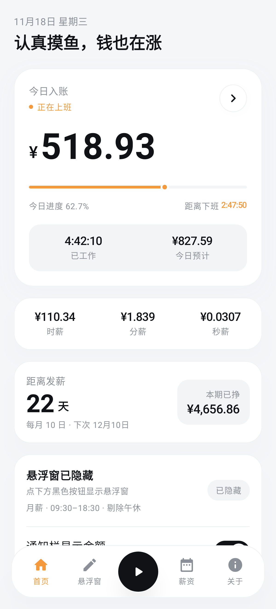
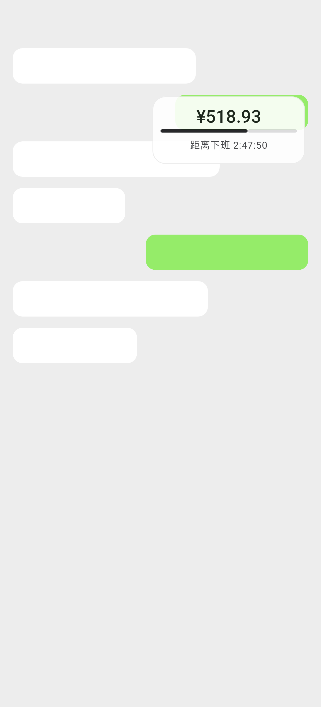
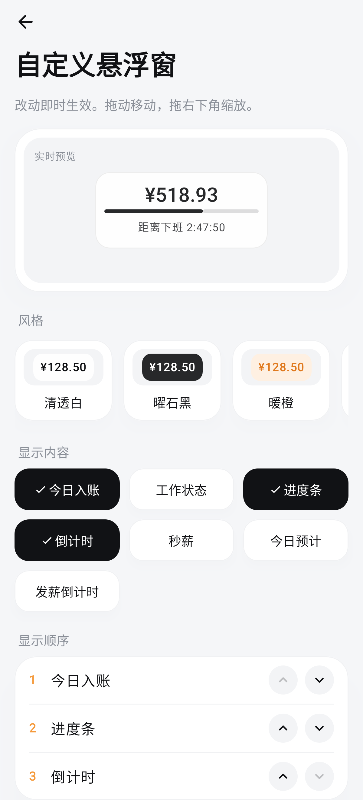
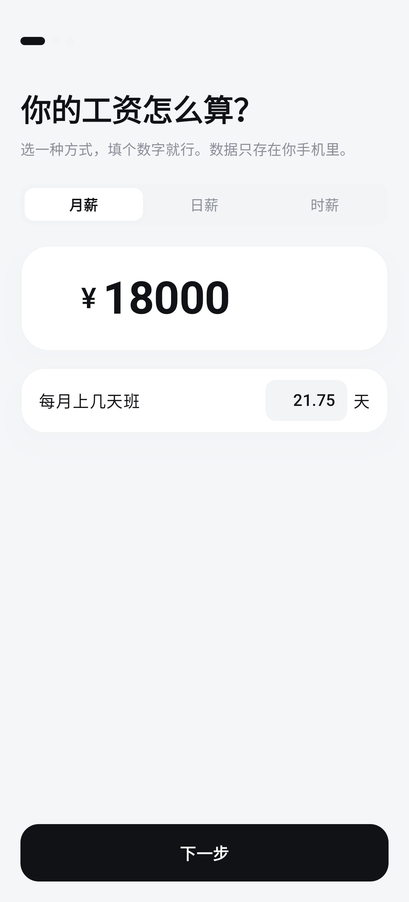
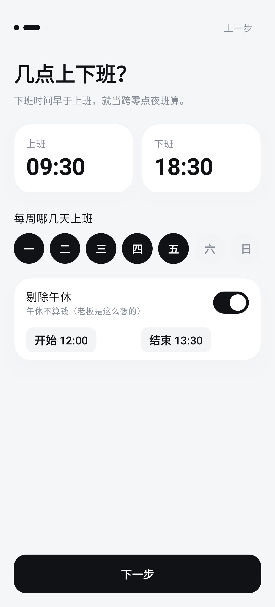
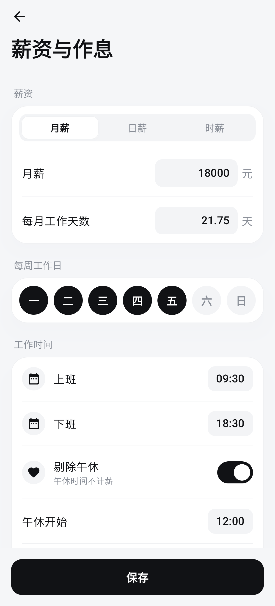
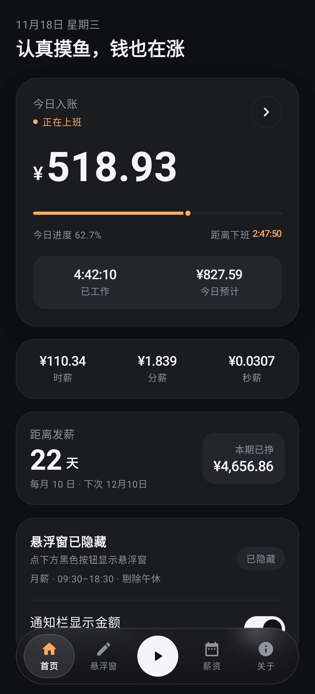

<p align="center"></p>

<h1 align="center">摸鱼币 MoneyTick</h1>

<p align="center"><b>上班的每一秒都在进账，现在你能亲眼看着它涨。</b></p>

<p align="center">
  <a href="https://github.com/DuDu-26/MoneyTick/releases/latest"></a>
  
  
</p>

<p align="center"><b>简体中文</b> · <a href="docs/README_EN.md">English</a> · <a href="docs/README_JA.md">日本語</a></p>

<p align="center">
  
  
  
</p>

## 这是个啥

开会开了一小时？恭喜，这一小时值 ¥103.45。

摸鱼币会把你的工资换算到**每一秒**，在手机上实时显示「今天已经挣了多少」。它还能在任何 App 上面挂一个小悬浮窗。刷短视频、回消息、假装看文档的时候，余光一扫，钱在涨。

它不会让你工资变多，但会让你上班的心情好一点点。

## 能干什么

- **实时进账**：今日入账精确到分，一分钱一分钱往上跳。月薪、日薪、时薪都能算，支持每周工作日、剔除午休和跨零点夜班。
- **悬浮窗**：可以挂在任何界面上，拖动能移动，大小在自定义页用滑条调，窗口上干干净净没有多余的把手。显示什么你说了算：金额、状态、进度条、下班倒计时、秒薪、今日预计、发薪倒计时，想放几个放几个，顺序也能排。大小、字号、透明度、圆角和颜色都能调，还能把背景直接调成透明，只留一串数字飘在屏幕上。现成风格有五套。
- **一键隐身**：双击悬浮窗它就消失。老板路过的时候特别好用。回到 App 首页点一下黑色按钮，它就回来。
- **发薪倒计时**：告诉它几号发工资，首页会显示还要熬几天，以及这个发薪周期已经挣了多少。
- **通知栏**：下拉通知栏就能看到今日入账、离下班还有多久、离发薪还有几天。
- **三步上手**：第一次打开有向导，选工资类型、填上下班时间、设发薪日，三十秒搞定。
- **深色模式**：跟随系统，也可以手动切换。

<p align="center">
  
  
  
  
</p>

## 下载安装

1. 到 [Releases](https://github.com/DuDu-26/MoneyTick/releases/latest) 下载最新的 `MoneyTick-v版本号.apk`，直接安装。
2. 第一次开悬浮窗时，系统会让你授予「显示在其他应用上层」的权限，打开就行。
3. 想在通知栏看金额，就允许通知权限。

> 需要 Android 8.0 或以上。从 v0.4.0 开始用固定签名，以后都能直接覆盖升级。之前装过旧版的话，先卸载一次。

## 钱是怎么算的

- **月薪**：月薪 ÷ 每月工作天数 = 日薪。日薪按当天工作时长平均分到每一秒。
- **日薪**：直接按当天工作时长平均分。
- **时薪**：时薪 × 当天工作时长 = 日薪。
- 午休时间不计钱，进度条也会停。下班时间早于上班时间，就按跨零点夜班算。
- 本期已挣：从上一个发薪日的第二天算起，把每个工作日的全天工资加起来，再加上今天已经挣到的。

## 省电吗

省。悬浮窗本身不做任何动画，息屏之后完全停止刷新，App 退到后台也会停。下班和休息日每分钟才刷新一次。通知栏每 15 秒更新一次，息屏不更新。还嫌费电的话，可以在设置里把刷新频率调到 5 秒或 1 分钟。

## 隐私

不联网，不用注册账号，没有统计，也没有广告。你的工资只保存在你自己的手机里，我们看不到，也不想看。

## 常见问题

**金额准吗？** 和你自己用计算器按的一样准。至于跟工资条对不对得上，要看你们公司怎么扣钱。

**老板看到悬浮窗怎么办？** 双击它。

**为什么叫摸鱼币？** 因为你摸鱼的时候，它也在涨。

## 开发

- Kotlin、Jetpack Compose、Material 3，minSdk 26，targetSdk 35。
- `core/` 是纯 Kotlin 的薪资计算引擎，带单元测试，不依赖 Android。`app/` 是界面和悬浮窗前台服务。
- 截图由 `app/src/test/.../ScreenshotTest.kt` 用 Robolectric 渲染。

```bash
./gradlew :core:test            # 单元测试（没有 Android SDK 时加 -PcoreOnly=true）
./gradlew :app:assembleDebug    # 打包调试 APK
```

想发新版？只要改 `app/build.gradle.kts` 里的 `versionName`，推到 main，CI 会自动发 Release。路线图见 [docs/PLAN.md](docs/PLAN.md)。

## 作者

**dudu**（[@DuDu-26](https://github.com/DuDu-26)）

## 许可

AGPL-3.0-only，见 [LICENSE](LICENSE) 和 [附加条款](legal/ADDITIONAL_TERMS.md)。本项目基于 [PayDance](https://github.com/MrBaoboer/PayDance) 修改，是非官方版本，原作 Copyright (C) 2026 Mr.Baoboer；新增和修改的部分 Copyright (C) 2026 dudu。
