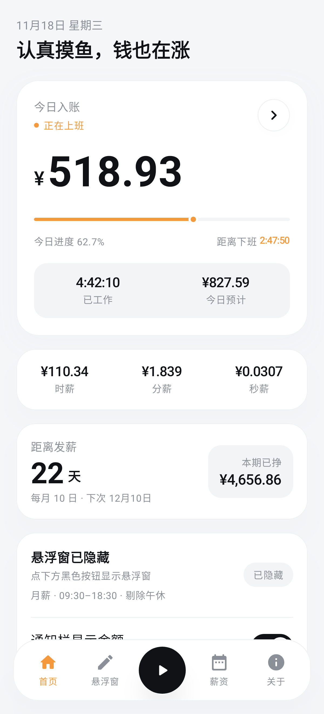
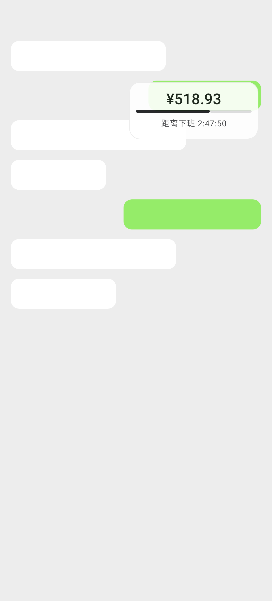
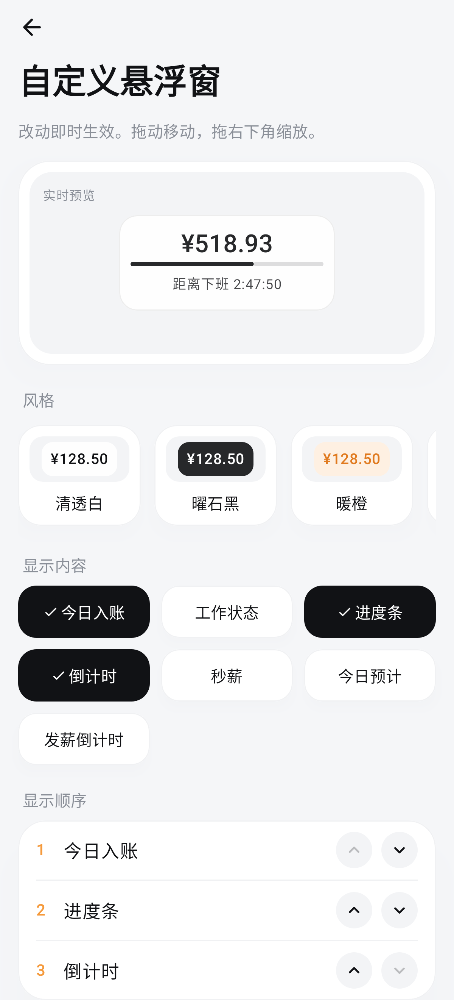
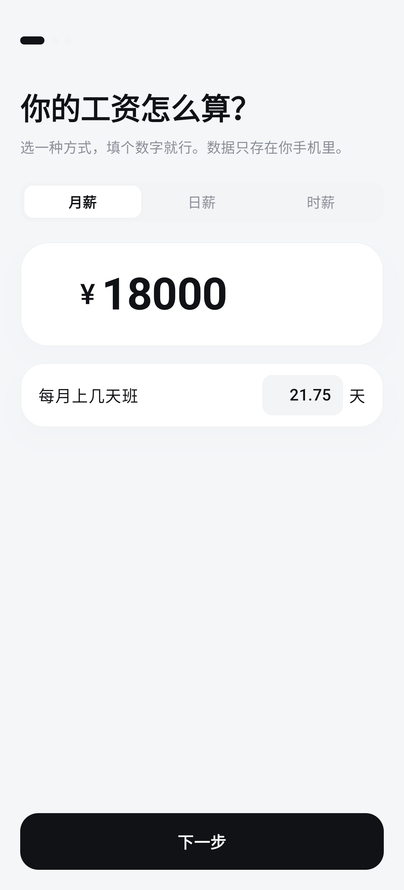
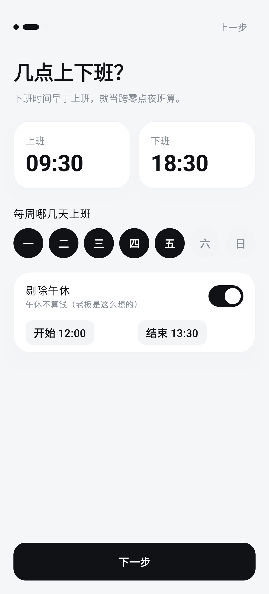
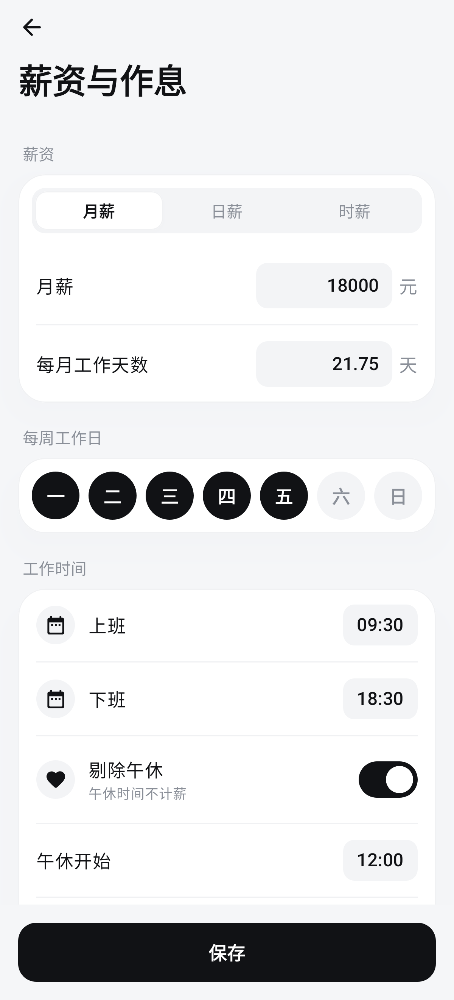
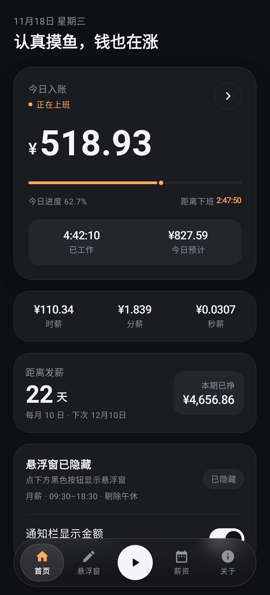

<p align="center"></p>

<h1 align="center">MoneyTick</h1>

<p align="center"><b>Every second at work pays. Now you get to watch it happen.</b></p>

<p align="center">
  <a href="https://github.com/DuDu-26/MoneyTick/releases/latest"></a>
  
  
</p>

<p align="center"><a href="../README.md">简体中文</a> · <b>English</b> · <a href="README_JA.md">日本語</a></p>

<p align="center">
  
  
  
</p>

> The app's interface is currently in Chinese. English is on the roadmap.

## What is this?

That one-hour meeting? It just earned you ¥103.45.

MoneyTick (摸鱼币, "slacking coin") breaks your salary down to **the second** and shows what you've earned today, live, on your phone. It can also pin a tiny floating window on top of any app, so whether you're scrolling videos, answering chats or pretending to read a spec, one glance tells you the money is still coming in.

It won't make your salary bigger. It might make your workday a little nicer.

## Features

- **Live earnings**: today's total ticks up one cent at a time. Monthly, daily and hourly pay are all supported, along with custom workdays, unpaid lunch breaks and night shifts that cross midnight.
- **Floating window**: sits on top of any app. Drag it to move it; its size is set with sliders on the customize screen, so the window itself has no handles. You choose what it shows (amount, status, progress bar, time until clocking out, per-second rate, today's target, days to payday) and in what order. Size, font, opacity, corner radius and colours are all adjustable. The background can even be fully transparent, leaving just the numbers floating on screen. There are five ready-made styles.
- **Instant vanish**: double-tap the floating window and it disappears. Very handy when the boss walks by. Tap the black button on the home screen to bring it back.
- **Payday countdown**: tell it which day you get paid. The home screen then shows how many days are left and how much you've earned so far this pay period.
- **Notification shade**: pull down to see today's earnings, time until clocking out and days to payday.
- **Three-step setup**: on first launch, pick your pay type, set your hours and choose your payday. About thirty seconds.
- **Dark mode**: follows the system, or set it yourself.

<p align="center">
  
  
  
  
</p>

## Install

1. Download the latest `MoneyTick-v<version>.apk` from [Releases](https://github.com/DuDu-26/MoneyTick/releases/latest) and install it.
2. The first time you turn on the floating window, Android asks for the "Display over other apps" permission. Allow it.
3. To see earnings in the notification shade, allow notifications.

> Requires Android 8.0 or later. From v0.4.0 every release is signed with the same key, so updates install over the old version. If you installed an earlier build, uninstall it once first.

## How the math works

- **Monthly**: monthly pay ÷ workdays per month = daily pay, spread evenly over the seconds you work that day.
- **Daily**: daily pay spread evenly over the day's working time.
- **Hourly**: hourly rate × hours worked that day = daily pay.
- Lunch breaks are unpaid and pause the progress bar. If your end time is earlier than your start time, it counts as a night shift.
- Earned this pay period: every full workday since the day after your last payday, plus what you've earned so far today.

## Battery

The floating window has no animations at all. Updates stop completely when the screen is off, and when the app is in the background. On rest days and after work, it refreshes once a minute. The notification refreshes every 15 seconds, and never while the screen is off. If you want even less, set the refresh rate to 5 seconds or 1 minute.

## Privacy

No network access, no account, no analytics, no ads. Your salary stays on your phone. We can't see it, and we don't want to.

## FAQ

**Is the number accurate?** As accurate as doing it on a calculator. Whether it matches your payslip depends on your company's deductions.

**What if my boss sees the floating window?** Double-tap it.

**Why "slacking coin"?** Because it keeps going up while you're slacking.

## Development

- Kotlin, Jetpack Compose and Material 3. minSdk 26, targetSdk 35.
- `core/` is the salary engine: pure Kotlin with unit tests and no Android dependencies. `app/` holds the UI and the floating-window foreground service.
- Screenshots are rendered with Robolectric by `app/src/test/.../ScreenshotTest.kt`.

```bash
./gradlew :core:test            # unit tests (add -PcoreOnly=true without an Android SDK)
./gradlew :app:assembleDebug    # debug APK
```

To ship a release, bump `versionName` in `app/build.gradle.kts` and push to `main`. CI publishes it automatically.

## Author

**dudu** ([@DuDu-26](https://github.com/DuDu-26))

## License

AGPL-3.0-only. See [LICENSE](../LICENSE) and the [additional terms](../legal/ADDITIONAL_TERMS.md). This is an unofficial modified version of [PayDance](https://github.com/MrBaoboer/PayDance), Copyright (C) 2026 Mr.Baoboer. New and modified parts are Copyright (C) 2026 dudu.
