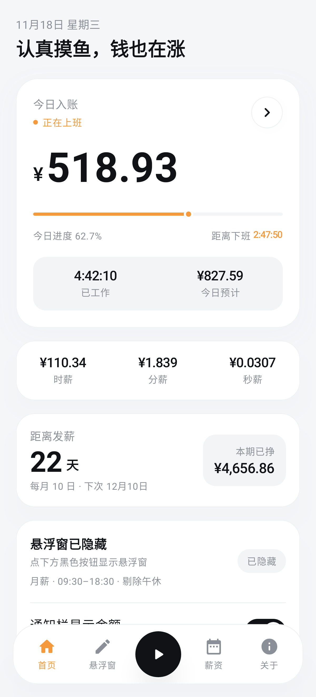
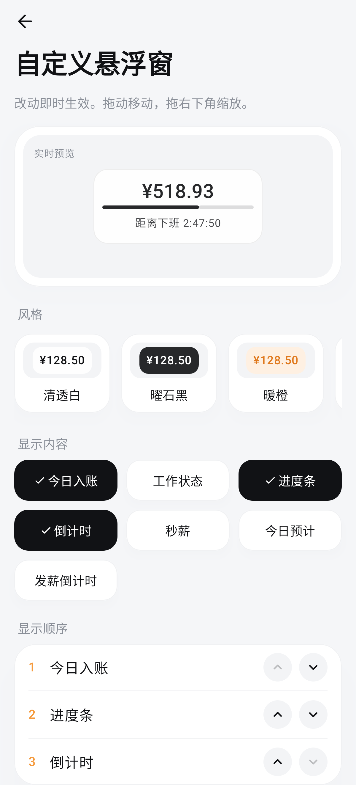
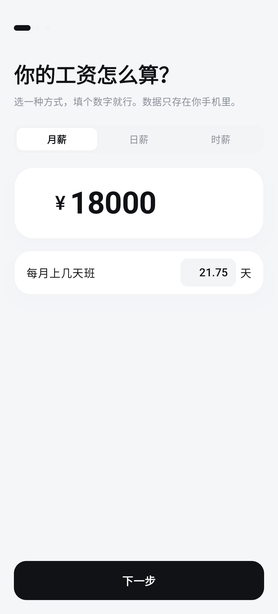
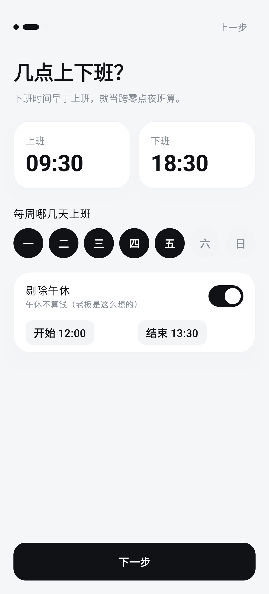
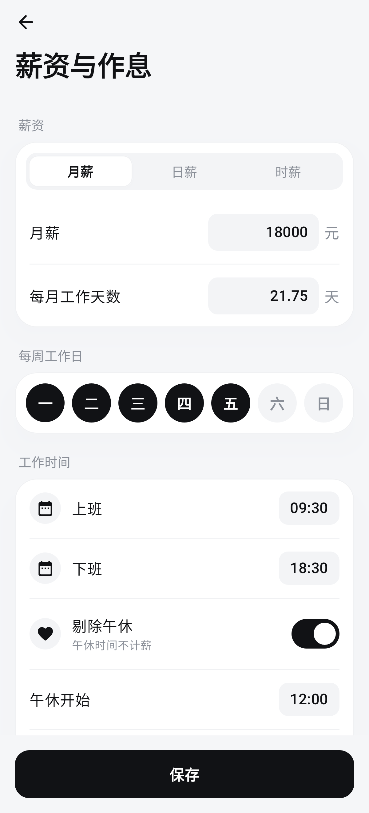
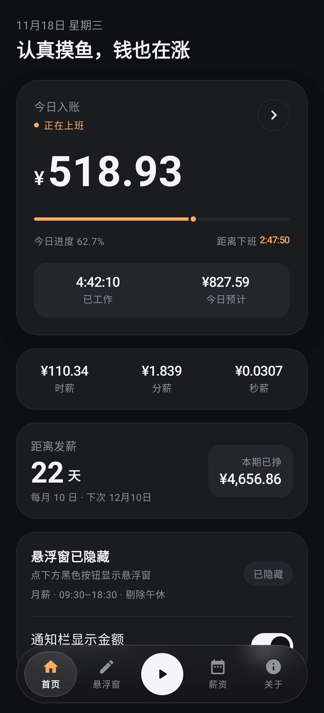

<p align="center"></p>

<h1 align="center">摸鱼币 MoneyTick</h1>

<p align="center"><b>働いている一秒一秒にお金が入ってくる。それが目の前で見えるアプリ。</b></p>

<p align="center">
  <a href="https://github.com/DuDu-26/MoneyTick/releases/latest"></a>
  
  
</p>

<p align="center"><a href="../README.md">简体中文</a> · <a href="README_EN.md">English</a> · <b>日本語</b></p>

<p align="center">
  
  
  
</p>

> アプリの画面は現在中国語のみです。多言語対応は今後予定しています。

## これは何？

1 時間の会議、お疲れさまでした。その 1 時間で ¥103.45 稼ぎました。

摸鱼币（「サボりコイン」という意味）は、お給料を**1 秒単位**に換算して、「今日いくら稼いだか」をスマホにリアルタイムで表示します。どのアプリの上にも小さなフローティングウィンドウを置けるので、動画を見ていても、チャットを返していても、資料を読むふりをしていても、ちらっと見ればお金が増えているのがわかります。

お給料は増えません。でも、仕事中の気分が少しだけ良くなるかもしれません。

## できること

- **リアルタイム収入**：今日の収入が 1 分（0.01 元）ずつ増えていきます。月給・日給・時給に対応し、勤務曜日、昼休みの除外、日付をまたぐ夜勤も計算できます。
- **フローティングウィンドウ**：どの画面の上にも表示できます。ドラッグで移動、右下の角をドラッグでサイズ変更。表示する項目（金額、状態、進捗バー、退勤までのカウントダウン、秒給、今日の見込み、給料日までの日数）と並び順は自由に決められます。サイズ、文字の大きさ、透明度、角の丸み、色も調整でき、4 種類のスタイルも用意しています。
- **ワンタップで消える**：フローティングウィンドウをダブルタップすると消えます。上司が通りかかったときに便利です。アプリのホームで黒いボタンを押せば戻ります。
- **給料日カウントダウン**：給料日を設定すると、あと何日か、今の給与期間にいくら稼いだかをホームに表示します。
- **通知バー**：通知を下ろすだけで、今日の収入、退勤までの時間、給料日までの日数がわかります。
- **3 ステップの初期設定**：初回起動時に、給与の種類、勤務時間、給料日を選ぶだけ。30 秒で終わります。
- **ダークモード**：システム設定に合わせるか、手動で切り替えられます。

<p align="center">
  
  
  
  
</p>

## インストール

1. [Releases](https://github.com/DuDu-26/MoneyTick/releases/latest) から最新の `MoneyTick-v<バージョン>.apk` をダウンロードしてインストールします。
2. 初めてフローティングウィンドウをオンにすると、「他のアプリの上に重ねて表示」の許可を求められるので、許可してください。
3. 通知バーに金額を表示したい場合は、通知を許可してください。

> Android 8.0 以上が必要です。v0.4.0 からは同じ鍵で署名しているので、上書きでアップデートできます。それより前のビルドを入れている場合は、一度アンインストールしてください。

## 計算方法

- **月給**：月給 ÷ 月の勤務日数 = 日給。それをその日の勤務時間で 1 秒ごとに均等に割ります。
- **日給**：日給をその日の勤務時間で均等に割ります。
- **時給**：時給 × その日の勤務時間 = 日給。
- 昼休みは計算に含まれず、進捗バーも止まります。退勤時刻が出勤時刻より早い場合は、日付をまたぐ夜勤として計算します。
- 今期の収入：前回の給料日の翌日から、各勤務日の 1 日分の給与を合計し、今日ここまでの分を足したものです。

## バッテリー

フローティングウィンドウはアニメーションを一切使いません。画面がオフのときや、アプリがバックグラウンドにあるときは更新を完全に止めます。退勤後や休日は 1 分に 1 回だけ更新します。通知は 15 秒ごとに更新し、画面オフ中は更新しません。もっと節約したい場合は、更新頻度を 5 秒または 1 分に設定できます。

## プライバシー

ネット接続なし、アカウント登録なし、解析なし、広告なし。お給料のデータはあなたのスマホの中だけに保存されます。私たちには見えませんし、見るつもりもありません。

## よくある質問

**金額は正確？** 電卓で計算するのと同じくらい正確です。給与明細と合うかどうかは、会社の控除しだいです。

**上司にフローティングウィンドウを見られたら？** ダブルタップしてください。

**なぜ「サボりコイン」？** サボっている間も増え続けるからです。

## 開発

- Kotlin、Jetpack Compose、Material 3。minSdk 26、targetSdk 35。
- `core/` は給与計算エンジンで、Android に依存しない純粋な Kotlin とユニットテストです。`app/` は画面とフローティングウィンドウのフォアグラウンドサービスです。
- スクリーンショットは `app/src/test/.../ScreenshotTest.kt` が Robolectric で描画しています。

```bash
./gradlew :core:test            # ユニットテスト（Android SDK がない場合は -PcoreOnly=true）
./gradlew :app:assembleDebug    # デバッグ用 APK
```

リリースするには、`app/build.gradle.kts` の `versionName` を上げて `main` に push するだけです。CI が自動で公開します。

## 作者

**dudu**（[@DuDu-26](https://github.com/DuDu-26)）

## ライセンス

AGPL-3.0-only。[LICENSE](../LICENSE) と[追加条項](../legal/ADDITIONAL_TERMS.md)をご覧ください。本プロジェクトは [PayDance](https://github.com/MrBaoboer/PayDance) を改変した非公式版で、原著作は Copyright (C) 2026 Mr.Baoboer、追加・変更部分は Copyright (C) 2026 dudu です。
